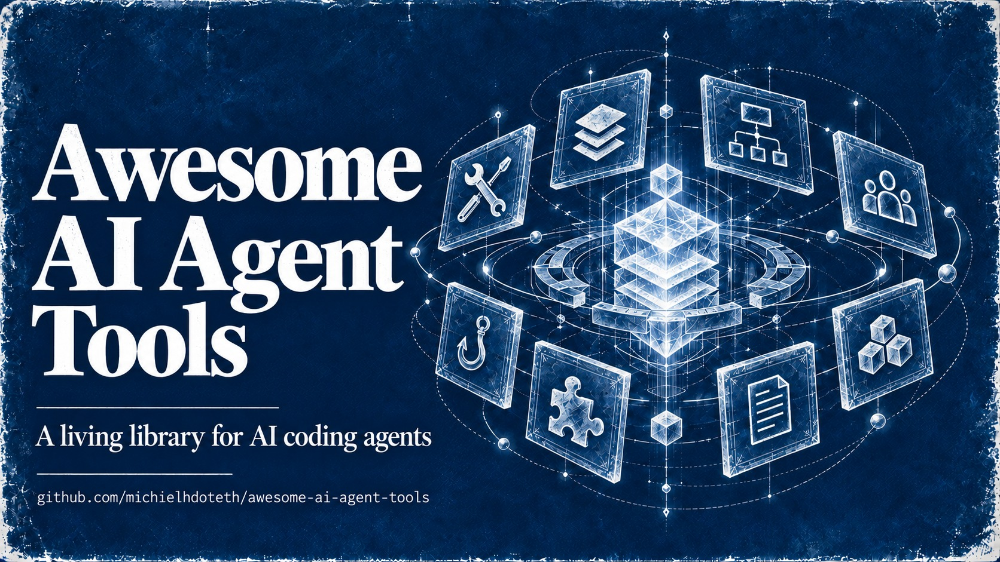

# Awesome AI Agent Tools

Skills, MCP servers, agent workflows, subagents, hooks, plugins, prompts, and CLI tools for AI coding assistants.

**681** installable components across **8** categories. Every entry is sourced from a real open-source project. Works with Claude Code, OpenCode, Codex, Cursor, Gemini CLI, Copilot, and 30+ AI coding assistants.

## Contents

- [Skills](#skills)
- [MCPs](#mcps)
- [Agent Loops](#agent-loops)
- [Subagents](#subagents)
- [Hooks](#hooks)
- [Plugins](#plugins)
- [Prompts](#prompts)
- [Tools](#tools)

## Skills

100 skills across 9 categories: Development (32) · Productivity (18) · Design (11) · Content (10) · DevOps (9) · Testing (6) · Data (6) · Marketing (6) · Security (2)

**[Browse all 100 skills in skills/](skills/)** · [catalog.json](skills/catalog.json)

Top 5 shown:

| Name                        | Description                                                                                                   | Source                     |
| --------------------------- | ------------------------------------------------------------------------------------------------------------- | -------------------------- |
| Executing Plans             | Executes implementation plans with verification at each step.                                                 | `obra/superpowers`         |
| Frontend Design             | Creates distinctive, production-grade frontend interfaces with high design quality.                           | `anthropics/skills`        |
| Grill Me                    | Get relentlessly interviewed about a plan or design until every branch of the decision tree is resolved.      | `mattpocock/skills`        |
| Vercel React Best Practices | React and Next.js performance optimization guidelines from Vercel Engineering. 40+ rules across 8 categories. | `vercel-labs/agent-skills` |
| Find Skills                 | Discover and install new skills for your agent.                                                               | `vercel-labs/skills`       |

## MCPs

185 mcps across 19 categories: Developer Tools (24) · Research & Data (18) · Search (16) · AI & Machine Learning (16) · Agent Orchestration (16) · Communication (14) · Databases (10) · Marketing (10) · Security (10) · Finance (8) · DevOps (8) · Browser Automation (7) · Monitoring (7) · Official Reference (6) · Cloud Platforms (5) · Blockchain (4) · Design (3) · Mobile (2) · Data Engineering (1)

**[Browse all 185 mcps in mcps/](mcps/)** · [catalog.json](mcps/catalog.json)

Top 5 shown:

| Name            | Description                                                                                                                                           | Source                         |
| --------------- | ----------------------------------------------------------------------------------------------------------------------------------------------------- | ------------------------------ |
| n8n MCP         | Fair-code workflow automation platform with native AI capabilities and 400+ integrations                                                              | `n8n-io/n8n`                   |
| MarkItDown      | Converts PDF, Office, HTML and image files into clean Markdown for AI consumption                                                                     | `microsoft/markitdown`         |
| Browser Use MCP | AI-powered browser automation with 100K+ stars. Enables agents to browse the web, fill forms, extract data, and interact with web pages autonomously. | `browser-use/browser-use`      |
| Filesystem MCP  | Secure file read/write/list/search operations with configurable directory access controls                                                             | `modelcontextprotocol/servers` |
| Netdata MCP     | Real-time infrastructure monitoring with MCP integration for system metrics                                                                           | `netdata/netdata`              |

## Agent Loops

104 loops across 7 categories: engineering (53) · multi-agent (14) · evaluation (12) · meta (10) · operations (6) · design (6) · content (3)

**[Browse all 104 loops in loops/](loops/)** · [catalog.json](loops/catalog.json)

Top 5 shown:

| Name                 | Description                                                                        | Source                                 |
| -------------------- | ---------------------------------------------------------------------------------- | -------------------------------------- |
| The docs sweep       | Keeps documentation aligned with the current codebase                              | `Forward-Future/loopy`                 |
| Daily Triage Pattern | 1d-2h maintenance loop for triaging issues, PRs, and priorities                    | `cobusgreyling/loop-engineering`       |
| Issue Burn-Down Line | Curated backlog through worker, QA, and checkpoint stations                        | `rohanbalkondekar/agent-loop-patterns` |
| Alpha Loop           | Agent-agnostic automated development loop: Plan -> Build -> Test -> Review -> Ship | `bradtaylorsf/alpha-loop`              |
| The Workflow Loop    | Complete shipping loop for coding agents with Plan/Execute/Land/Learn phases       | `iKon85/agent-workflow-kit`            |

## Subagents

31 subagents across 5 categories: Subagent Collection (15) · Agent Harness (6) · Official SDK (4) · Platform Format (4) · Curated Directory (2)

**[Browse all 31 subagents in subagents/](subagents/)** · [catalog.json](subagents/catalog.json)

Top 5 shown:

| Name                          | Description                                                                                                                                                                            | Source                                    |
| ----------------------------- | -------------------------------------------------------------------------------------------------------------------------------------------------------------------------------------- | ----------------------------------------- |
| oh-my-openagent               | Agent harness with async subagent orchestration. Manages subagent delegation, parallel execution, and result aggregation across multiple agent personas.                               | `code-yeongyu/oh-my-openagent`            |
| Microsoft Agent Framework     | Microsoft's comprehensive framework for building autonomous AI agents with multi-agent patterns, Azure integration, and .NET/Python support.                                           | `learn.microsoft.com`                     |
| awesome-claude-code           | Ecosystem directory indexing 47K+ stars of Claude Code resources including subagent collections, skills, MCP servers, and community extensions.                                        | `hesreallyhim/awesome-claude-code`        |
| awesome-claude-code-subagents | Curated list of 154+ Claude Code subagent definitions including code-reviewer, debugger, test-writer, planner, and more. VoltAgent's definitive collection of reusable agent personas. | `VoltAgent/awesome-claude-code-subagents` |
| oh-my-codex                   | Codex orchestration harness with 33 agent prompts. Manages subagent lifecycle, handoffs, and coordinated task execution for Codex CLI.                                                 | `Yeachan-Heo/oh-my-codex`                 |

## Hooks

25 hooks across 7 categories: Security (5) · Session Management (5) · Automation (4) · Quality (3) · Safety (3) · Utility (3) · Notifications (2)

**[Browse all 25 hooks in hooks/](hooks/)** · [catalog.json](hooks/catalog.json)

Top 5 shown:

| Name                                     | Description                                                                                                                                              | Source                                 |
| ---------------------------------------- | -------------------------------------------------------------------------------------------------------------------------------------------------------- | -------------------------------------- |
| Secret Scanner                           | Scans for leaked secrets (API keys, tokens, passwords) before writing or editing files                                                                   | `rohitg00/awesome-claude-code-toolkit` |
| Block Dangerous Commands                 | Blocks rm -rf, fork bombs, curl\|sh, and other destructive shell commands                                                                                | `karanb192/claude-code-hooks`          |
| Lasso Security Prompt Injection Defenses | Enterprise-grade prompt injection detection and prevention hooks for Claude Code. Detects and blocks indirect prompt injection attacks via tool outputs. | `lasso-security/claude-hooks`          |
| awesome-claude-code-hooks                | Curated directory of Claude Code hooks organized by category. Meta-resource for discovering hooks in the ecosystem.                                      | `ithiria894/awesome-claude-code-hooks` |
| AWS Credential Check                     | Warns before each prompt when Claude Code's AWS Bedrock credentials are expired or near expiry                                                           | `GeiserX/cc-aws-keepalive`             |

## Plugins

59 plugins across 11 categories: Claude Code (15) · Cross-Tool (10) · OpenCode (9) · VS Code AI (6) · Cursor (5) · Windsurf (4) · JetBrains (4) · Copilot (3) · Aider (1) · Codex (1) · Hermes Agent (1)

**[Browse all 59 plugins in plugins/](plugins/)** · [catalog.json](plugins/catalog.json)

Top 5 shown:

| Name                             | Description                                                                                                           | Source                          |
| -------------------------------- | --------------------------------------------------------------------------------------------------------------------- | ------------------------------- |
| Superpowers Plugin               | Comprehensive skill pack with 60+ pre-built skills for Claude Code workflows                                          | `superpowers.dev`               |
| Official Claude Code Marketplace | Official marketplace for Claude Code plugins with 255+ community-contributed extensions                               | `claude.ai`                     |
| Awesome CursorRules              | Curated collection of cursor rules by PatrickJS with 20K stars                                                        | `PatrickJS/awesome-cursorrules` |
| AgentEnv                         | Project-scoped AI agent and plugin environment manager. Manages agent configurations across multiple AI coding tools. | `kvcache-ai/AgentENV`           |
| Oh My Hermes                     | Hermes Agent workflow plugin with project memory and task-specific model and reasoning routing.                       | `rlaope/oh-my-hermes`           |

## Prompts

85 prompts across 17 categories: Coding (9) · Architecture (8) · Image Generation (8) · General Purpose (7) · DevOps (6) · Code Review (5) · Debugging (5) · Documentation (5) · Reasoning (5) · Testing (4) · Data (4) · Design (4) · Productivity (4) · Agent Workflows (4) · Security (3) · Content (3) · Marketplace (1)

**[Browse all 85 prompts in prompts/](prompts/)** · [catalog.json](prompts/catalog.json)

Top 5 shown:

| Name                            | Description                                                                   | Source                             |
| ------------------------------- | ----------------------------------------------------------------------------- | ---------------------------------- |
| Senior Code Reviewer            | Thorough code review with security, performance, and maintainability analysis | `f/prompts.chat`                   |
| Prompt Engineer                 | Meta-prompt for designing and optimizing other prompts                        | `dair-ai/Prompt-Engineering-Guide` |
| Craft Code Refactor             | Systematic code improvement with test coverage maintenance                    | `hoangatg/awesome-ai-prompts-2026` |
| SQL Query Optimizer             | Analyze and optimize SQL queries with index suggestions                       | `openai/openai-cookbook`           |
| Image Generation Prompt Crafter | Craft detailed prompts for DALL-E, Midjourney, and Flux                       | `Ryan-yang125/gpt-image-2-prompts` |

## Tools

92 tools across 15 categories: AI Coding CLIs (17) · Code Analysis (12) · Cloud & DevOps (7) · Formatting & Linting (7) · Agent Training & Eval (7) · Git Utilities (6) · Package Managers (5) · Docker & Containers (5) · API Testing (5) · Agent Memory (4) · Database CLIs (4) · Monitoring (4) · Terminal Enhancement (4) · AI APIs (3) · Agent Security (2)

**[Browse all 92 tools in tools/](tools/)** · [catalog.json](tools/catalog.json)

Top 5 shown:

| Name        | Description                                                          | Source                     |
| ----------- | -------------------------------------------------------------------- | -------------------------- |
| Ollama      | Run LLMs locally. Llama, Mistral, Phi, Gemma, and more.              | `ollama/ollama`            |
| Gemini CLI  | Google's AI coding agent in the terminal.                            | `google-gemini/gemini-cli` |
| Claude Code | Anthropic's agentic coding tool. Terminal-native AI pair programmer. | `anthropics/claude-code`   |
| Bun         | Incredibly fast JavaScript runtime, bundler, and package manager.    | `oven-sh/bun`              |
| Netdata     | Real-time performance and health monitoring.                         | `netdata/netdata`          |

## Contributing

We welcome contributions. You can:

1. Manual PR - fork, add an entry to a `catalog.json` file, validate, and submit. See [contributing.md](contributing.md).
2. Agent-automated - give your AI agent the contributing.md guide and it handles everything.
3. Open an issue to suggest a tool we should add.

All data comes from `catalog.json` files in each folder. These catalogs are the single source of truth for programmatic discovery.
